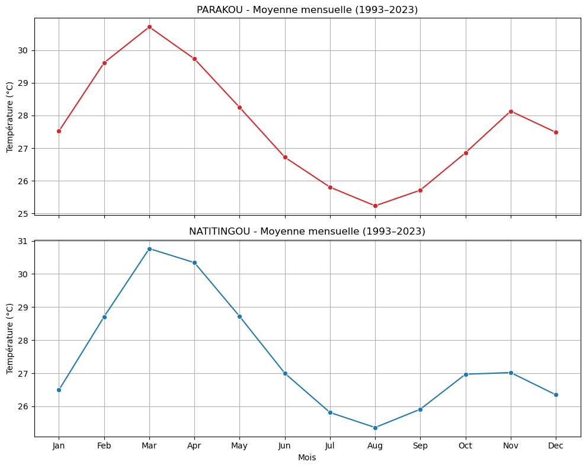

# 🌍 Climate Analysis — Parakou & Natitingou (1993–2023)

## 📌 Overview

This project analyzes **monthly mean temperatures** from two meteorological stations in Benin: **Parakou and Natitingou**, covering the period from 1993 to 2023.

The main objective is to understand seasonal temperature cycles, compare the temperature profiles of the two stations, and explore the potential implications of temperature variations for **agriculture, aquaculture, and sustainable water resource management**.

Daily observations are cleaned, processed, and aggregated into monthly averages to facilitate climate analysis and data visualization.

This project aims to answer four key questions:

1. How do monthly mean temperatures vary throughout the year in Parakou and Natitingou?
2. What similarities and differences can be observed between the seasonal temperature patterns of the two stations?
3. What interannual temperature variations can be identified between 1993 and 2023?
4. How can these findings potentially support agricultural and aquaculture activities?

---

## 🎯 Research Questions

### 1. Monthly Temperature Variations

Calculate and visualize monthly mean temperatures to identify the annual temperature cycle, from January to December, at each station.

### 2. Comparison of Seasonal Patterns

Compare the temperature curves of Parakou and Natitingou to identify similarities and differences in their seasonal patterns.

### 3. Long-Term Temperature Trends

Examine temperature variations between 1993 and 2023 to investigate potential warming or cooling trends. Confirming a long-term trend requires appropriate statistical analysis.

### 4. Practical Applications

Discuss the potential implications of seasonal temperature variations for agricultural planning, water requirements, and aquaculture management.

---

## 🛠️ Tools and Technologies

- **Python** — Main programming language used for data analysis.
- **Pandas** — Data cleaning, manipulation, transformation, and aggregation.
- **Matplotlib** — Data visualization and chart creation.
- **Seaborn** — Statistical data visualization.
- **Jupyter Notebook** — Interactive data exploration and documentation.
- **Visual Studio Code** — Development environment.
- **Git & GitHub** — Version control and project sharing.

---

## 🧹 Data Preparation and Cleaning

The dataset contains daily temperature observations from the Parakou and Natitingou meteorological stations.

The main data preparation steps include:

1. Loading the dataset from a CSV file.
2. Converting the `Date` column to datetime format.
3. Extracting the year and month from each observation.
4. Counting the available observations for each month.
5. Comparing the number of observed days with the expected number of calendar days.
6. Identifying incomplete months before proceeding with the analysis.

### Python Code

```python
import pandas as pd
import calendar

# Load the dataset
df = pd.read_csv("Temp_moy_obs.csv", sep=";")

# Convert Date to datetime
df["Date"] = pd.to_datetime(df["Date"])

# Extract year and month
df["year"] = df["Date"].dt.year
df["month"] = df["Date"].dt.month
df["month_name"] = df["Date"].dt.strftime("%b")

# Count observations for each year and month
days_count = (
    df.groupby(["year", "month"])
    .size()
    .reset_index(name="observed_days")
)

# Calculate the expected number of calendar days
days_count["expected_days"] = days_count.apply(
    lambda row: calendar.monthrange(
        row["year"], row["month"]
    )[1],
    axis=1
)

# Identify incomplete months
incomplete_months = days_count[
    days_count["observed_days"] != days_count["expected_days"]
]

print("Incomplete months detected:")
print(incomplete_months)
```

**Note:** This completeness check assumes that each row represents one daily observation and that there are no duplicate dates. If the dataset contains a station identifier, completeness should also be checked separately for each station. Missing observations and duplicate records should be investigated before calculating monthly averages.

[Click Here](analyse_temperature.ipynb)
---

## 📊 Results

### 1. Monthly Temperature Patterns

The monthly temperature profiles reveal a clear seasonal cycle at both stations.

- **Parakou:** Temperatures reach their highest levels around March–April, at approximately 30–31 °C, and decline to around 25 °C in August.
- **Natitingou:** Temperatures follow a similar seasonal pattern, with a peak around March and a minimum around August, based on the preliminary results.
- **Seasonality:** Both stations exhibit higher temperatures toward the end of the dry season and lower temperatures during the rainy season.

These values are approximate and should be interpreted in the context of the underlying dataset and aggregation method.

### 2. Comparison Between Parakou and Natitingou

- **Temperature differences:** Parakou appears to be slightly warmer on average, with an estimated difference of approximately 0.5–1 °C.
- **Similar seasonal patterns:** Both stations exhibit broadly similar annual temperature cycles.
- **Local climatic conditions:** The observed differences may be associated with geographical characteristics and other local environmental factors.

### Temperature Comparison



---

## 💡 Key Insights

- **Strong seasonality:** Temperatures peak around March–April and decline during July–August.
- **Local temperature differences:** Preliminary results suggest that Natitingou has a slightly milder temperature profile than Parakou.
- **Agricultural relevance:** Understanding seasonal temperature variations can support crop-calendar planning when combined with rainfall data, soil conditions, and crop-specific requirements.
- **Aquaculture relevance:** Temperature monitoring can support aquaculture management because water temperature affects aquatic organisms. However, air temperature alone is insufficient to determine optimal fish-rearing conditions.
- **Data quality:** Aggregating daily observations into monthly averages makes seasonal patterns easier to interpret. Checking data completeness and duplicate records helps improve the reliability of the analysis.

---

## ✅ Conclusion

This project provides an overview of monthly temperature variations in Parakou and Natitingou between 1993 and 2023.

The preliminary findings indicate that:

1. Both stations exhibit clear and broadly similar seasonal temperature cycles.
2. Parakou appears to have higher average temperatures, while both stations experience a marked temperature decline around August.
3. Monthly temperature analysis provides useful insights into local climatic conditions.
4. These findings can contribute to agricultural planning, water resource management, and aquaculture decision-making when combined with other relevant environmental data.

Overall, this project demonstrates how **Python-based data analysis can transform raw meteorological observations into meaningful climate indicators** that support environmental research and practical agricultural applications.

---

## 🚀 Future Improvements

- Investigate missing observations and duplicate records.
- Compare monthly mean temperatures across different years.
- Analyze long-term temperature trends using appropriate statistical methods.
- Incorporate rainfall and other meteorological variables.
- Explore relationships between temperature patterns and agricultural or aquaculture indicators.
- Develop an interactive dashboard to communicate the results.

---

*Project focus: Climate Data Analysis | Python | Data Visualization | Agriculture | Water Resources*